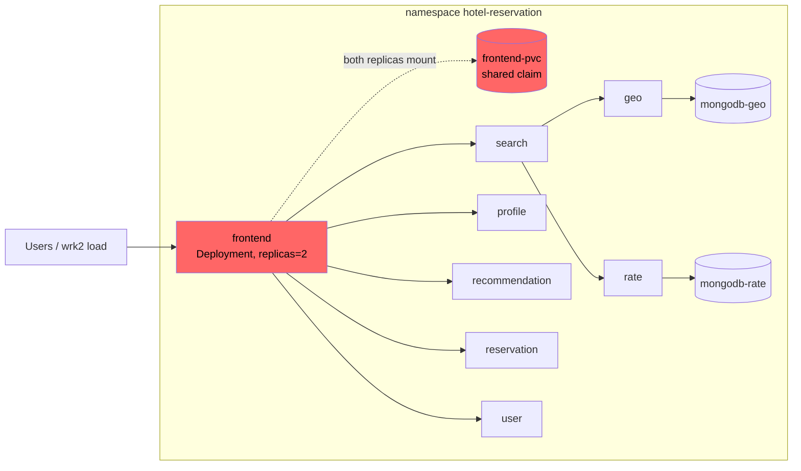

# Problem card: `duplicate_pvc_mounts_hotel_reservation`

Status: **draft**. Facts come from the 29 Oct run log (fault-injection output, judge verdict,
agent's submitted diagnosis). Items marked **[unverified]** still need a `kubectl` check or a read of
the SREGym problem source on a machine that has it.

## 1. The story in two sentences
The Hotel Reservation web frontend is redeployed with two replicas that both claim the same
persistent volume, so the second replica cannot start and the frontend is only half available. A
user mostly still gets pages (one replica serves), which is why this fault is easy to overlook.

## 2. System map

Red = where the fault lives. Everything behind the frontend is healthy; nothing in the chain needs
fixing except the frontend's storage claim and replica setup.

## 3. Fault mechanics
- **Injected how** (from the injection log): SREGym saved the frontend Deployment to
  `/tmp/deployment-state-hotel-reservation-frontend.yaml`, created a PVC named `frontend-pvc`,
  deleted the Deployment and re-created it with `replicas=2` and that one shared PVC mounted.
- **Why it breaks:** a ReadWriteOnce volume can only be attached to one node at a time. Two
  replicas that must share it either land on the same node (not allowed here, see anti-affinity
  below) or one of them waits forever for a volume that is attached elsewhere. **[unverified]:
  exact access mode and the anti-affinity rule are what the judge and the agent said they saw; read
  them with `kubectl get deploy frontend -n hotel-reservation -o yaml`.**
- **Symptoms an agent can see** **[unverified order]**:
  1. `kubectl get pods`: one frontend pod `Running`, the second `Pending` (or `ContainerCreating`).
  2. `kubectl describe pod <pending>`: events about scheduling or volume attach/mount.
  3. `kubectl get pvc`: `frontend-pvc` bound; `kubectl describe deploy frontend`: replicas 2, one volume.

## 4. What a correct diagnosis must say
From the judge rubric in the log (checklist ids D1-Q*, D2-Q*, D3-Q*):
- **D1 fault localization:** the frontend Deployment in `hotel-reservation`.
- **D2 fault characterization:** the root cause is the shared PersistentVolumeClaim (ReadWriteOnce,
  storage tied to one node) mounted by multiple replicas, **not** merely "not enough nodes".
- **D3 scope precision:** do not blame other services; mention the partially-ready frontend.

## 5. What a correct fix looks like
- **Accepted fix:** **[unverified, read the oracle]** remove the shared claim from the multi-replica
  Deployment (or reduce to one replica / give each replica its own volume) so all frontend pods
  become Ready and the frontend is healthy again.
- **Fake fixes to watch for:** deleting the Pending pod (it just comes back Pending); scaling other
  services; relaxing anti-affinity without addressing the volume (replicas may then co-locate but
  the claim problem remains **[unverified]**).
- **Needs shell?** Probably not. The typed catalogue has `scale_deployment`, `rollback_deployment`,
  `set_env`; a fix that edits the volume spec may need `kubectl patch`/`edit`, which only the
  `typed+shell` arm can do. **[unverified: check which fix the oracle accepts]**. Pilot: react-v1 passed
  3/3 on both arms, so the typed catalogue is enough in practice (probably `rollback_deployment` or
  `scale_deployment`).

## 6. Open questions this problem speaks to
- **C1 (diagnosis to valid action):** in the 29 Oct run the agent localised the fault but described
  the wrong mechanism. A wrong mechanism can still lead to a working fix (scale down), so this is a
  good case to ask whether D2 failures predict mitigation failures.
- **F1/F3 (evidence grounding):** did the agent ever read the PVC or the Deployment volumes before
  it concluded "anti-affinity"? Read the story for that.
- **G1 (shortcut audit):** is a plain `scale_deployment frontend 1` (fix without understanding) enough
  to pass? If yes, this problem rewards a shortcut.

## 7. Attempt log

| Attempt | Agent / action space / model | Result | failure_mode_tag | story | What we learned |
|---|---|---|---|---|---|
| A-0 (29 Oct) | react-v1 / typed / gemini-3.5-flash-lite | diag **fail** (0.67: D1 1.0, D2 0.0, D3 1.0); mitigation not run (driver crash, since fixed) | wrong-mechanism (proposed new tag) | `walkthrough/A-0/story.md` | Right component, wrong cause: said anti-affinity and node count, never the shared PVC. |
| A-1 | | | | | |

## 8. Experiments to run on this problem
- [ ] Re-run the same setup 3 times (A-1..A-3): is "missed the PVC" stable or a one-off?
- [ ] Read each story: did the agent run `get_resource pvc` or `describe deployment` at all? (If not,
      the question is why it did not look; if it did, why it did not use what it saw.)
- [ ] F2 (hypothesis ledger) on: does listing hypotheses make it test "storage" as well as "scheduling"?
- [ ] F6 (verify before submit): after the fix, would a check of frontend readiness catch a fix that
      does not hold?
