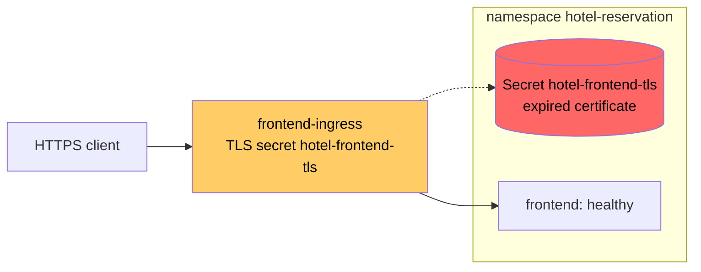

# Problem card: `expired_tls_hotel_reservation`

Status: **draft, from source only (30 Oct 2026)**. Nothing here comes from a run yet. The root cause, the injection
and the oracle names are read from the SREGym clone (`sregym/conductor/problems/`, `sregym/generators/fault/`).
Everything marked **[prediction]** or **[unverified]** is our reading and must be checked on a cluster or
after the first walkthrough run.

## 1. The story in two sentences
The frontend Ingress uses a TLS secret `hotel-frontend-tls` that holds an expired certificate. All pods are healthy; HTTPS connections to the site are what break, which is invisible at the pod level.

## 2. System map

Red = the secret with the expired certificate. Orange = the Ingress that serves it. SREGym installs ingress-nginx itself.

## 3. Fault mechanics
- **Injected how** (from the SREGym source): SREGym generates an expired certificate and key, creates the `kubernetes.io/tls` secret `hotel-frontend-tls`, and applies `frontend_ingress.yaml` (`expired_tls_hotel_reservation.py`). The code that would delete NGINX's default certificate is commented out, so NGINX may fall back to its default certificate **[unverified: what clients see]**.
- **Why it breaks:** The Ingress presents a certificate whose validity period has ended, so TLS validation fails for clients. Pods and services are healthy.
- **Symptoms an agent can see** **[prediction, order not checked on a cluster]**:
  1. `get_pod_status`: everything Running.
  2. `get_resource ingress frontend-ingress`: TLS section references `hotel-frontend-tls`.
  3. Decoding the certificate in the secret shows an expired `notAfter`. Ingress controller logs may report the expiry **[unverified]**.

## 4. What a correct diagnosis must say
Derived from the structured `root_cause` the SREGym judge compares against. The judge's own checklist items (D1-Q*, D2-Q*, D3-Q*) are only visible after a run, so add them to this card after the first attempt.
- **D1 fault localization:** Ingress `frontend-ingress` and its TLS secret `hotel-frontend-tls` in `hotel-reservation`.
- **D2 fault characterization:** The Ingress's TLS secret contains an expired certificate, which breaks HTTPS connections.
- **D3 scope precision:** Do not blame the frontend pods, the network or the service.

## 5. What a correct fix looks like
- **Accepted fix(es):** `ExpiredTlsMitigationOracle` (oracle code not read): replace the secret with a valid certificate. **[unverified: whether removing TLS from the Ingress also passes]**
- **Fake fixes:** Restarting pods; scaling; deleting the secret and leaving the Ingress pointing at it.
- **Needs shell?** **[prediction]** Needs shell. Producing a new certificate and secret has no typed action.

## 6. Open questions this problem speaks to
Tags are in `docs/research/open-questions.md`. Confirm the tags when the card is reviewed; the ones named in section 8 are suggestions.

## 7. Attempt log

| Attempt | Agent / action space / model | Result (diag, mit, e2e) | failure_mode_tag | story | What we learned |
|---|---|---|---|---|---|

## 8. Experiments to run on this problem
- [ ] Typed vs typed+shell
- [ ] Does the agent look at certificates at all when pods are healthy? (B4)
