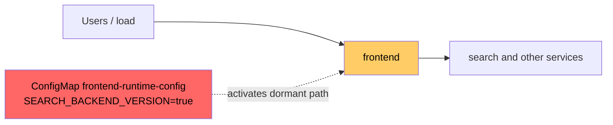

# Problem card: `feature_flag_latent_bug_hotel_reservation`

Status: **draft, from source only (30 Oct 2026)**. Nothing here comes from a run yet. The root cause, the injection
and the oracle names are read from the SREGym clone (`sregym/conductor/problems/`, `sregym/generators/fault/`).
Everything marked **[prediction]** or **[unverified]** is our reading and must be checked on a cluster or
after the first walkthrough run.

## 1. The story in two sentences
A ConfigMap flag `SEARCH_BACKEND_VERSION` is set to true, activating a dormant code path in the frontend image. Every hotel search now returns HTTP 500, but all pods stay Running with no crash. The incident is modelled on the Fastly outage of 8 June 2021.

## 2. System map

Red = the flag. Orange = the frontend that now returns 500 on `/hotels`. Everything behind it is healthy.

## 3. Fault mechanics
- **Injected how** (from the SREGym source): SREGym swaps the frontend to an image that contains the dormant path and sets the flag in `frontend-runtime-config`; recovery restores the original image (`inject_feature_flag_experimental_routing`; exact image mechanics not reviewed).
- **Why it breaks:** A configuration change enables a code path that errors on every search request. Because the process does not crash, Kubernetes sees nothing wrong; only the service-level error rate shows it.
- **Symptoms an agent can see** **[prediction, order not checked on a cluster]**:
  1. `get_pod_status`: all pods Running.
  2. `get_logs` frontend: HTTP 500 on search requests **[unverified wording]**.
  3. `get_resource configmap frontend-runtime-config`: `SEARCH_BACKEND_VERSION: true`.

## 4. What a correct diagnosis must say
Derived from the structured `root_cause` the SREGym judge compares against. The judge's own checklist items (D1-Q*, D2-Q*, D3-Q*) are only visible after a run, so add them to this card after the first attempt.
- **D1 fault localization:** `deployment/frontend` in `hotel-reservation` (its config).
- **D2 fault characterization:** `SEARCH_BACKEND_VERSION` was set to true in `frontend-runtime-config`, activating a dormant error path that returns HTTP 500 on every search; pods stay Running.
- **D3 scope precision:** Do not blame the search or backend services or a crash/restart loop.

## 5. What a correct fix looks like
- **Accepted fix(es):** Compound oracle (`MitigationOracle` plus an HTTP probe of the search endpoint): set the flag back to false in the ConfigMap and roll out the frontend so the change is picked up.
- **Fake fixes:** Restarting without changing the flag; scaling the frontend; changing the search service.
- **Needs shell?** **[prediction]** Typed is enough: `patch_configmap_key` (flag to false) then `restart_deployment`. This is the one dev problem where a typed-only run should be able to fix it end to end.

## 6. Open questions this problem speaks to
Tags are in `docs/research/open-questions.md`. Confirm the tags when the card is reviewed; the ones named in section 8 are suggestions.

## 7. Attempt log

| Attempt | Agent / action space / model | Result (diag, mit, e2e) | failure_mode_tag | story | What we learned |
|---|---|---|---|---|---|
| Ladder round 1 (3 Nov 2026), 15 variants x 1 repeat | `reliops_v1` / `reliops_v2` variants, `gemini-3.5-flash-lite` (agent and judge) | diag 4/15, mit 4/15, e2e 2/15 | - | stories in the Lab export | Correct when the frontend ConfigMap was read. c4 and c5 changed the flag without restarting the frontend, so it was not picked up. The rest blamed downstream services or startup noise. |

## 8. Experiments to run on this problem
- [ ] Typed-only baseline: does it fix without shell?
- [ ] Does the agent restart before changing the flag (a fake fix)? (C1)
