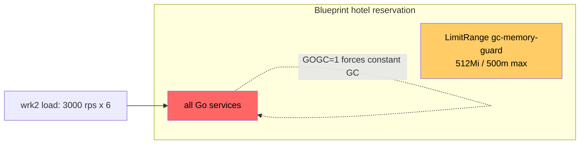

# Problem card: `gc_capacity_degradation`

Status: **draft, from source only (30 Oct 2026)**. Nothing here comes from a run yet. The root cause, the injection
and the oracle names are read from the SREGym clone (`sregym/conductor/problems/`, `sregym/generators/fault/`).
Everything marked **[prediction]** or **[unverified]** is our reading and must be checked on a cluster or
after the first walkthrough run.

**Validation needed before this counts in dev-12:** it uses the Blueprint app variant, a 3000 rps x 6 workload, and an alert-based oracle that needs the monitoring stack. Confirm it deploys and fits on the 32 GB machine, and that the oracle turns green after a manual fix, before trusting any score.

## 1. The story in two sentences
Every workload in the Blueprint variant of Hotel Reservation is patched to run with `GOGC=1`, so the Go runtime collects garbage constantly and burns CPU. Under the sustained load SREGym starts, latency rises and capacity drops, but pods stay Running and nothing crashes.

## 2. System map

Red = every deployment (the fault is global, not one service). Orange = a LimitRange SREGym adds so the extra CPU use shows up as pressure. Exact service list **[unverified]**: the Blueprint variant differs from the Hotel Reservation used elsewhere.

## 3. Fault mechanics
- **Injected how** (from the SREGym source): SREGym applies a LimitRange (`gc-memory-guard`: default 512Mi memory and 500m CPU, same maximums), then patches every deployment's environment with `GOGC=1` (rolling restart), then starts a continuous workload (`gc_capacity_degradation.py`).
- **Why it breaks:** A very low GOGC makes the Go garbage collector run after almost every allocation. CPU goes to GC instead of requests, so throughput falls and latency rises under load. It is a metastable-style capacity regime: the system is up but degraded.
- **Symptoms an agent can see** **[prediction, order not checked on a cluster]**:
  1. `get_pod_status`: everything Running; maybe CPU near the 500m limit **[unverified]**.
  2. `get_logs`: no errors, slow responses **[unverified]**.
  3. `describe`/`get_resource` on a deployment: env var `GOGC=1` present on all of them. **[unverified]**

## 4. What a correct diagnosis must say
Derived from the structured `root_cause` the SREGym judge compares against. The judge's own checklist items (D1-Q*, D2-Q*, D3-Q*) are only visible after a run, so add them to this card after the first attempt.
- **D1 fault localization:** All deployments in the application namespace (`deployments/all`), not one service.
- **D2 fault characterization:** An aggressively low `GOGC` setting forces frequent garbage collection, consuming CPU and holding the system in a degraded high-latency regime under load.
- **D3 scope precision:** Do not blame a single service, the load generator or the node; the fault is global and configuration-level.

## 5. What a correct fix looks like
- **Accepted fix(es):** **[unverified, read `AlertOracle`]** The oracle is alert based (it excludes `HighRequestRate`), so the fix must make the latency/CPU alerts clear under the sustained workload. Reverting `GOGC` on all deployments is the evident fix.
- **Fake fixes:** Restarting pods (they come back with `GOGC=1`); scaling one service; raising limits without touching `GOGC` **[prediction]**.
- **Needs shell?** **[prediction]** Typed `set_env` can do it, but must be applied once per deployment, so a typed run needs many correct steps.

## 6. Open questions this problem speaks to
Tags are in `docs/research/open-questions.md`. Confirm the tags when the card is reviewed; the ones named in section 8 are suggestions.

## 7. Attempt log

| Attempt | Agent / action space / model | Result (diag, mit, e2e) | failure_mode_tag | story | What we learned |
|---|---|---|---|---|---|

## 8. Experiments to run on this problem
- [ ] Typed with a hint that the fault is global vs no hint
- [ ] Verification step: wait for alerts to clear under load before declaring success (C2)
