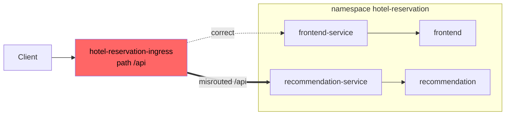

# Problem card: `ingress_misroute`

Status: **draft, from source only (30 Oct 2026)**. Nothing here comes from a run yet. The root cause, the injection
and the oracle names are read from the SREGym clone (`sregym/conductor/problems/`, `sregym/generators/fault/`).
Everything marked **[prediction]** or **[unverified]** is our reading and must be checked on a cluster or
after the first walkthrough run.

## 1. The story in two sentences
An Ingress in front of Hotel Reservation sends the `/api` path to the recommendation service instead of the frontend. Requests reach a real service, so nothing is down, but the answers are wrong for the route.

## 2. System map

Red = the Ingress rule. The dotted arrow is where `/api` should go; the thick arrow is where it goes. SREGym installs ingress-nginx and creates the two proxy services itself.

## 3. Fault mechanics
- **Injected how** (from the SREGym source): SREGym deploys ingress-nginx, creates `frontend-service` (to frontend :5000) and `recommendation-service` (to recommendation :8085), creates the Ingress if missing, then edits the `/api` backend to `recommendation-service` (`ingress_misroute.py`).
- **Why it breaks:** The Ingress points a valid path at the wrong backend. There is no crash or event; the symptom is wrong or inconsistent API behavior on that route.
- **Symptoms an agent can see** **[prediction, order not checked on a cluster]**:
  1. `get_pod_status`: everything Running.
  2. Requests to `/api` return responses that do not match the frontend **[unverified]**.
  3. `get_resource ingress hotel-reservation-ingress`: backend for `/api` is `recommendation-service`.

## 4. What a correct diagnosis must say
Derived from the structured `root_cause` the SREGym judge compares against. The judge's own checklist items (D1-Q*, D2-Q*, D3-Q*) are only visible after a run, so add them to this card after the first attempt.
- **D1 fault localization:** Ingress `hotel-reservation-ingress` in `hotel-reservation`.
- **D2 fault characterization:** The backend rule for path `/api` routes to `recommendation-service` instead of `frontend-service` (wrong backend, not a connectivity failure).
- **D3 scope precision:** Do not blame the recommendation or frontend pods; both are healthy.

## 5. What a correct fix looks like
- **Accepted fix(es):** `IngressMisrouteMitigationOracle`: point the `/api` rule back to `frontend-service`. **[unverified: exact checks]**
- **Fake fixes:** Restarting pods; scaling frontend or recommendation; deleting the Ingress (removes the route entirely).
- **Needs shell?** **[prediction]** Needs shell. No typed action edits an Ingress. Diagnosis is possible with typed `get_resource`.

## 6. Open questions this problem speaks to
Tags are in `docs/research/open-questions.md`. Confirm the tags when the card is reviewed; the ones named in section 8 are suggestions.

## 7. Attempt log

| Attempt | Agent / action space / model | Result (diag, mit, e2e) | failure_mode_tag | story | What we learned |
|---|---|---|---|---|---|

## 8. Experiments to run on this problem
- [ ] Typed vs typed+shell
- [ ] Does the agent look at the Ingress at all when pods are healthy? (B1/B4)
