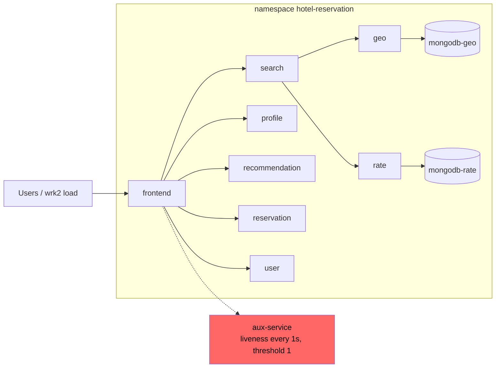

# Problem card: `liveness_probe_too_aggressive_hotel_reservation`

Status: **draft, from source only (30 Oct 2026)**. Nothing here comes from a run yet. The root cause, the injection
and the oracle names are read from the SREGym clone (`sregym/conductor/problems/`, `sregym/generators/fault/`).
Everything marked **[prediction]** or **[unverified]** is our reading and must be checked on a cluster or
after the first walkthrough run.

## 1. The story in two sentences
A custom service called `aux-service` is deployed next to Hotel Reservation with a liveness probe set to fail after one second with no grace. The pod is killed and recreated in a loop, so the service flaps and users see intermittent errors.

## 2. System map

Red = `aux-service`, a deliberately slow custom service SREGym deploys (`custom/slow_service.py`). How the frontend depends on it **[unverified]**.

## 3. Fault mechanics
- **Injected how** (from the SREGym source): SREGym deploys the slow service, then deletes and recreates its Deployment with `initialDelaySeconds=0`, `periodSeconds=1`, `failureThreshold=1` on the liveness probe and `terminationGracePeriodSeconds=0` (`inject_liveness_probe_too_aggressive`).
- **Why it breaks:** A slow-starting container fails the first one-second probe and is killed immediately with no grace, so it never stabilizes. This produces repeated restarts and readiness instability.
- **Symptoms an agent can see** **[prediction, order not checked on a cluster]**:
  1. `get_pod_status`: `aux-service` pod with a rising restart count.
  2. `get_events`: `Unhealthy` liveness probe failures, `Killing`.
  3. `describe deployment aux-service`: the probe values above.

## 4. What a correct diagnosis must say
Derived from the structured `root_cause` the SREGym judge compares against. The judge's own checklist items (D1-Q*, D2-Q*, D3-Q*) are only visible after a run, so add them to this card after the first attempt.
- **D1 fault localization:** `aux-service` deployment in `hotel-reservation`.
- **D2 fault characterization:** Overly aggressive liveness probe (`initialDelaySeconds=0`, `periodSeconds=1`, `failureThreshold=1`) with zero termination grace kills pods before they stabilize.
- **D3 scope precision:** Do not blame the node, the image's code or other services.

## 5. What a correct fix looks like
- **Accepted fix(es):** `SustainedReadinessOracle` (30 s sustained readiness): relax the probe (delay, period, threshold) so pods stay ready for 30 seconds.
- **Fake fixes:** Restarting or scaling (the loop continues); removing the probe entirely may or may not pass **[unverified]**.
- **Needs shell?** **[prediction]** Needs shell. The Deployment is recreated, so `rollback_deployment` has no earlier revision, and no typed action edits probes.

## 6. Open questions this problem speaks to
Tags are in `docs/research/open-questions.md`. Confirm the tags when the card is reviewed; the ones named in section 8 are suggestions.

## 7. Attempt log

| Attempt | Agent / action space / model | Result (diag, mit, e2e) | failure_mode_tag | story | What we learned |
|---|---|---|---|---|---|
| Ladder round 1 (3 Nov 2026), 15 variants x 1 repeat | `reliops_v1` / `reliops_v2` variants, `gemini-3.5-flash-lite` (agent and judge) | diag 5/15, mit 3/15, e2e 1/15 | - | stories in the Lab export | 11 of 15 anchored on 'Address already in use' and rewrote `service.py` in the ConfigMap (application code, outside our scope). Probe-only patches (`initialDelaySeconds` only) failed; the 3 passes combined that patch with the code edit. Nobody fixed `periodSeconds`, `failureThreshold` or `terminationGracePeriodSeconds`, the infrastructure-only fix. |

## 8. Experiments to run on this problem
- [ ] Typed vs typed+shell
- [ ] Does the agent mistake restarts for an app crash instead of a probe problem? (B5)
