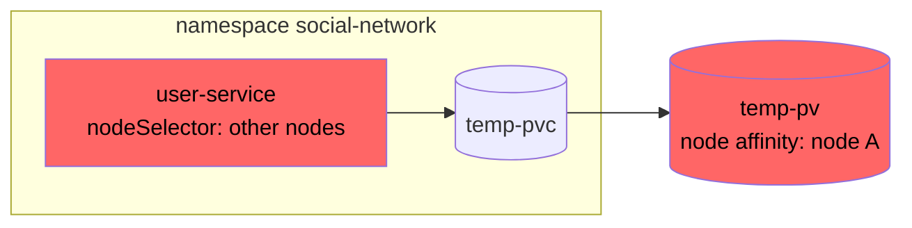

# Problem card: `persistent_volume_affinity_violation`

Status: **draft, from source only (30 Oct 2026)**. Nothing here comes from a run yet. The root cause, the injection
and the oracle names are read from the SREGym clone (`sregym/conductor/problems/`, `sregym/generators/fault/`).
Everything marked **[prediction]** or **[unverified]** is our reading and must be checked on a cluster or
after the first walkthrough run.

**Blocker to check first:** the injector raises 'Need 2 worker nodes' unless the cluster has at least two non-control-plane nodes. A single-node kind cluster cannot run this problem, so confirm the local cluster shape before it is counted in dev-12.

## 1. The story in two sentences
In Social Network, `user-service` is tied to a PersistentVolume that only exists on one node while its pod selector points to other nodes. The scheduler can never satisfy both, so the pod stays Pending.

## 2. System map

Red = the unsatisfiable pair: volume pinned to node A, pod pinned elsewhere. Exact wiring of the deployment edit **[unverified]**; the visible part of the injector creates `temp-pv` and `temp-pvc`.

## 3. Fault mechanics
- **Injected how** (from the SREGym source): SREGym lists the non-control-plane nodes (needs at least two, otherwise it raises), creates PV `temp-pv` with node affinity to node A and a PVC `temp-pvc` bound to it, and modifies `user-service` to use them with a node selector for a different node (`inject_persistent_volume_affinity_violation`; the deployment edit is further down the function and was not read).
- **Why it breaks:** A pod that uses a volume with node affinity must run on that node. The pod's own nodeSelector targets other nodes, so no node satisfies both and the scheduler leaves the pod Pending.
- **Symptoms an agent can see** **[prediction, order not checked on a cluster]**:
  1. `get_pod_status`: `user-service` pod `Pending`.
  2. `get_events`: FailedScheduling with a volume node affinity conflict.
  3. `describe pod` / `get_resource pv`: affinity to one node, selector for another.

## 4. What a correct diagnosis must say
Derived from the structured `root_cause` the SREGym judge compares against. The judge's own checklist items (D1-Q*, D2-Q*, D3-Q*) are only visible after a run, so add them to this card after the first attempt.
- **D1 fault localization:** `user-service` deployment in `social-network` (the default faulty service).
- **D2 fault characterization:** The PV's node affinity and the pod's `nodeSelector` target different node sets, an unsatisfiable placement; pods stay Pending.
- **D3 scope precision:** Do not blame cluster capacity or other services.

## 5. What a correct fix looks like
- **Accepted fix(es):** Standard `MitigationOracle`: make the placement satisfiable, for example fix the nodeSelector or the volume binding. **[unverified: exact checks]**
- **Fake fixes:** Scaling the deployment; deleting the pod (it goes Pending again).
- **Needs shell?** **[prediction]** Needs shell (edit the pod template or the PV/PVC).

## 6. Open questions this problem speaks to
Tags are in `docs/research/open-questions.md`. Confirm the tags when the card is reviewed; the ones named in section 8 are suggestions.

## 7. Attempt log

| Attempt | Agent / action space / model | Result (diag, mit, e2e) | failure_mode_tag | story | What we learned |
|---|---|---|---|---|---|
| Ladder round 1 (3 Nov 2026), 15 variants x 1 repeat | `reliops_v1` / `reliops_v2` variants, `gemini-3.5-flash-lite` (agent and judge) | diag 15/15, mit 13/15, e2e 13/15 | - | stories in the Lab export | Easy: patch the nodeSelector. t1 (typed) tried `rollback_deployment`, which has no earlier revision here. |

## 8. Experiments to run on this problem
- [ ] Typed vs typed+shell
- [ ] Reading events vs describing the pod: which evidence does the agent use first?
