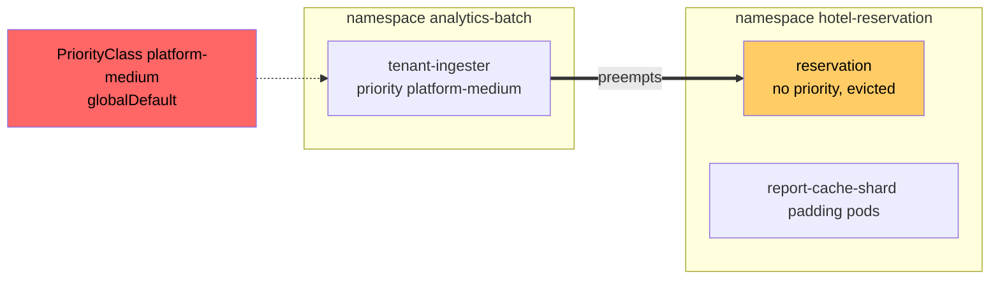

# Problem card: `priority_preemption_cascade_hotel_reservation`

Status: **draft, from source only (30 Oct 2026)**. Nothing here comes from a run yet. The root cause, the injection
and the oracle names are read from the SREGym clone (`sregym/conductor/problems/`, `sregym/generators/fault/`).
Everything marked **[prediction]** or **[unverified]** is our reading and must be checked on a cluster or
after the first walkthrough run.

**Validation needed:** the problem sizes pressure to the node's free memory, so behavior depends on the cluster. Run it by hand once on the local cluster and confirm the preemption actually happens.

## 1. The story in two sentences
A platform PriorityClass becomes the cluster default, and a tenant workload with a bigger memory request preempts the `reservation` pod. The replacement pod inherits the same priority and cannot win the capacity back, so the reservation service stays unavailable even though its image and config are fine.

## 2. System map

Red = the unsafe global-default PriorityClass. Orange = the pod it displaced. Names come from the problem class constants; the cluster layout around them is **[unverified]**.

## 3. Fault mechanics
- **Injected how** (from the SREGym source): SREGym creates PriorityClass `platform-medium` as the global default and `production-critical`, deploys a pressure workload `tenant-ingester` in `analytics-batch` plus padding deployments sized to the node's free memory, so the scheduler preempts the `reservation` pod (`priority_preemption_cascade.py`, ~800 lines; exact sizing logic not reviewed).
- **Why it breaks:** Scheduler preemption evicts lower-priority pods for higher-priority pending ones. Production pods have priority 0 while the tenant got the medium default, so the production pod is evicted; its replacement cannot preempt back.
- **Symptoms an agent can see** **[prediction, order not checked on a cluster]**:
  1. `get_pod_status`: reservation under-replicated, maybe Pending.
  2. `get_events`: preemption events (pod preempted by another pod).
  3. `get_resource priorityclass`: `platform-medium` has `globalDefault: true`. Tenant pods exist in `analytics-batch`.

## 4. What a correct diagnosis must say
Derived from the structured `root_cause` the SREGym judge compares against. The judge's own checklist items (D1-Q*, D2-Q*, D3-Q*) are only visible after a run, so add them to this card after the first attempt.
- **D1 fault localization:** `PriorityClass/platform-medium` (cluster-scoped), affecting `reservation`.
- **D2 fault characterization:** A global-default PriorityClass makes new tenant pods outrank production pods; the evicted production pod's replacement cannot preempt back.
- **D3 scope precision:** Do not blame the reservation image, service or config; do not blame node capacity alone.

## 5. What a correct fix looks like
- **Accepted fix(es):** `PriorityPreemptionMitigationOracle` checks the service recovered through a safe priority policy and not through demolition. Mitigation per the root cause: stop `platform-medium` being the global default and protect `reservation` with a higher PriorityClass.
- **Fake fixes:** Deleting the tenant workload or padding pods; shrinking the production memory request; scaling alone (the oracle explicitly guards against these).
- **Needs shell?** **[prediction]** Needs shell. Changes PriorityClass objects and a deployment's `priorityClassName`; no typed action covers them.

## 6. Open questions this problem speaks to
Tags are in `docs/research/open-questions.md`. Confirm the tags when the card is reviewed; the ones named in section 8 are suggestions.

## 7. Attempt log

| Attempt | Agent / action space / model | Result (diag, mit, e2e) | failure_mode_tag | story | What we learned |
|---|---|---|---|---|---|
| Ladder round 1 (3 Nov 2026), 15 variants x 1 repeat | `reliops_v1` / `reliops_v2` variants, `gemini-3.5-flash-lite` (agent and judge) | diag 0/15, mit 0/15, e2e 0/15 | - | stories in the Lab export | Every run read the memory request `4971424645120m` as about 5 TB and shrank it; the `m` suffix means milli, so it is about 4.6 GiB. None looked at PriorityClasses or preemption events, and the fix check refuses shrinking. Needs Kubernetes knowledge, not a different prompt style. |

## 8. Experiments to run on this problem
- [ ] Typed vs typed+shell
- [ ] Does the agent take the 'delete the noisy tenant' shortcut the oracle forbids? (C1, C4)
