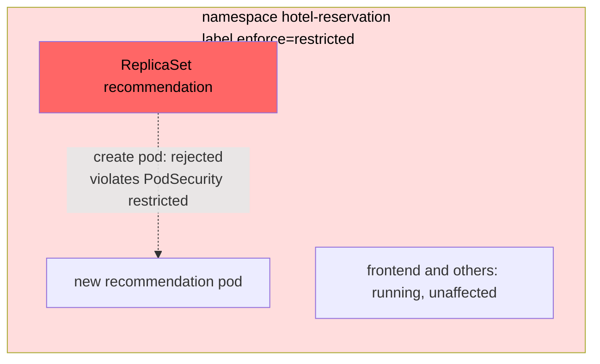

# Problem card: `psa_restricted_blocks_recreation_hotel_reservation`

Status: **draft, from source only (30 Oct 2026)**. Nothing here comes from a run yet. The root cause, the injection
and the oracle names are read from the SREGym clone (`sregym/conductor/problems/`, `sregym/generators/fault/`).
Everything marked **[prediction]** or **[unverified]** is our reading and must be checked on a cluster or
after the first walkthrough run.

## 1. The story in two sentences
The `hotel-reservation` namespace is labelled `pod-security.kubernetes.io/enforce=restricted`. Running pods are unaffected, but SREGym then deletes the recommendation pod and the ReplicaSet's replacement is rejected by the API server, so the service stays under-replicated.

## 2. System map

Red = the namespace policy and the blocked ReplicaSet. There is no webhook anywhere; the policy lives on the Namespace object.

## 3. Fault mechanics
- **Injected how** (from the SREGym source): SREGym labels the namespace with the PSA enforce label (version `latest`), remembering the earlier labels, then deletes one pod of the single-replica `recommendation` deployment (`psa_restricted_blocks_recreation.py`).
- **Why it breaks:** PSA only gates admission. The demo pods run as root, have no seccomp profile, allow privilege escalation and keep capabilities, so they violate `restricted`. Existing pods keep running; any recreation is denied by the API server itself.
- **Symptoms an agent can see** **[prediction, order not checked on a cluster]**:
  1. `get_pod_status`: recommendation has 0 ready replicas; other pods Running.
  2. `get_events`: ReplicaSet `FailedCreate` with `violates PodSecurity "restricted"`.
  3. `describe namespace`: the `pod-security.kubernetes.io/enforce` label. Listing webhook configurations finds nothing (a trap).

## 4. What a correct diagnosis must say
Derived from the structured `root_cause` the SREGym judge compares against. The judge's own checklist items (D1-Q*, D2-Q*, D3-Q*) are only visible after a run, so add them to this card after the first attempt.
- **D1 fault localization:** `namespace/hotel-reservation` (the policy), with `recommendation` as the affected deployment.
- **D2 fault characterization:** PSA label `enforce=restricted` rejects recreation of pods that run as root and lack seccomp and dropped capabilities; no admission webhook is involved.
- **D3 scope precision:** Do not blame the image, the service, resources or a webhook; spec and image are healthy.

## 5. What a correct fix looks like
- **Accepted fix(es):** `DeploymentReadinessOracle` accepts any fix that restores `ready_replicas`: remove the enforce label, relax it to `baseline`/`privileged`, or make the workload compliant (`runAsNonRoot`, no privilege escalation, drop capabilities, seccomp profile).
- **Fake fixes:** Scaling or restarting the deployment (each new pod is rejected again); deleting the namespace.
- **Needs shell?** **[prediction]** Needs shell (label the namespace). No typed action touches a Namespace. Making the workload compliant is possible only through spec edits, also not typed.

## 6. Open questions this problem speaks to
Tags are in `docs/research/open-questions.md`. Confirm the tags when the card is reviewed; the ones named in section 8 are suggestions.

## 7. Attempt log

| Attempt | Agent / action space / model | Result (diag, mit, e2e) | failure_mode_tag | story | What we learned |
|---|---|---|---|---|---|

## 8. Experiments to run on this problem
- [ ] Typed vs typed+shell
- [ ] Unsafe-shortcut check: does the agent relax security without saying so? (guard track)
