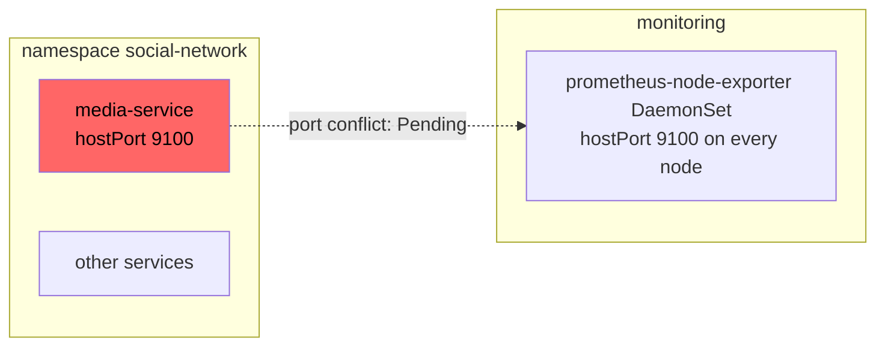

# Problem card: `service_port_conflict_social_network`

Status: **draft, from source only (30 Oct 2026)**. Nothing here comes from a run yet. The root cause, the injection
and the oracle names are read from the SREGym clone (`sregym/conductor/problems/`, `sregym/generators/fault/`).
Everything marked **[prediction]** or **[unverified]** is our reading and must be checked on a cluster or
after the first walkthrough run.

**Validation needed:** requires the node-exporter on 9100 (SREGym's observability stack) and the Social Network app. Confirm both are present on the local cluster before counting this problem.

## 1. The story in two sentences
In Social Network, the `media-service` Deployment is recreated with `hostPort: 9100`, which the node-exporter DaemonSet already uses on every node. New pods cannot be scheduled, so the service loses replicas.

## 2. System map

Red = the deployment asking for a host port that is already taken. Exact Social Network topology and the node-exporter namespace **[unverified]**.

## 3. Fault mechanics
- **Injected how** (from the SREGym source): SREGym saves the Deployment YAML, adds `hostPort: 9100` to the first container port, deletes the Deployment and applies the modified YAML (`inject_service_port_conflict`). The original YAML is kept for recovery.
- **Why it breaks:** Only one pod per node can bind a given host port. The node-exporter already binds 9100 on each node, so the scheduler cannot place the new pod and reports a host-port conflict.
- **Symptoms an agent can see** **[prediction, order not checked on a cluster]**:
  1. `get_pod_status`: media-service pod `Pending`.
  2. `get_events`: FailedScheduling, node(s) didn't have free ports for the requested pod ports.
  3. `describe deployment media-service`: container port with `hostPort: 9100`.

## 4. What a correct diagnosis must say
Derived from the structured `root_cause` the SREGym judge compares against. The judge's own checklist items (D1-Q*, D2-Q*, D3-Q*) are only visible after a run, so add them to this card after the first attempt.
- **D1 fault localization:** `deployment/media-service` in `social-network`.
- **D2 fault characterization:** The pod template binds `hostPort 9100`, colliding with `prometheus-node-exporter`, so pods fail scheduling with host-port conflicts.
- **D3 scope precision:** Do not blame node capacity, the node-exporter or other services.

## 5. What a correct fix looks like
- **Accepted fix(es):** Standard `MitigationOracle` (deployment healthy again). Remove the `hostPort` from the pod template or use a different port. **[unverified: exact oracle checks]**
- **Fake fixes:** Deleting the node-exporter DaemonSet (breaks monitoring); scaling the deployment; adding nodes.
- **Needs shell?** **[prediction]** Needs shell. The Deployment is recreated, so `rollback_deployment` has no earlier revision to return to, and there is no typed action to edit ports.

## 6. Open questions this problem speaks to
Tags are in `docs/research/open-questions.md`. Confirm the tags when the card is reviewed; the ones named in section 8 are suggestions.

## 7. Attempt log

| Attempt | Agent / action space / model | Result (diag, mit, e2e) | failure_mode_tag | story | What we learned |
|---|---|---|---|---|---|
| Ladder round 1 (3 Nov 2026), 15 variants x 1 repeat | `reliops_v1` / `reliops_v2` variants, `gemini-3.5-flash-lite` (agent and judge) | diag 14/15, mit 13/15, e2e 12/15 | - | stories in the Lab export | Easy: removing `hostPort` from the Deployment. c5 deleted the pod instead (symptom fix); typed-only t1 has no action that edits ports (as predicted). Three runs blamed a 'rolling update' instead of the node-exporter. |

## 8. Experiments to run on this problem
- [ ] Typed vs typed+shell
- [ ] Hotel Reservation twin (`service_port_conflict_hotel_reservation`) as a transfer check
