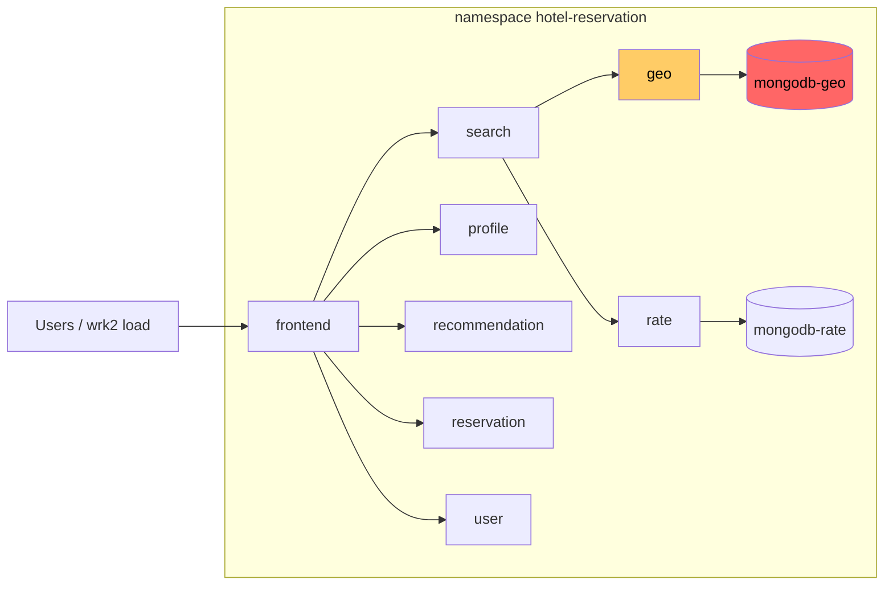

# Problem card: `silent_data_corruption`

Status: **draft, from source only (30 Oct 2026)**. Nothing here comes from a run yet. The root cause, the injection
and the oracle names are read from the SREGym clone (`sregym/conductor/problems/`, `sregym/generators/fault/`).
Everything marked **[prediction]** or **[unverified]** is our reading and must be checked on a cluster or
after the first walkthrough run.

**Validation needed:** the injection needs a hostPath or local PV and a node-level script pod. Confirm it works on the local cluster, and that the oracle can be satisfied by an action available to the agent, before counting it.

## 1. The story in two sentences
The data files behind `mongodb-geo` are overwritten with random bytes at the storage layer, with no I/O error. MongoDB's WiredTiger detects checksum failures and aborts on every start, so the database sits in CrashLoopBackOff and everything depending on geo fails.

## 2. System map

Red = the corrupted database. Orange = its dependent service. The fault is in the volume contents, below Kubernetes objects.

## 3. Fault mechanics
- **Injected how** (from the SREGym source): SREGym scales `mongodb-geo` to 0, finds the node and host path of its volume, runs a node-level pod that overwrites the WiredTiger files with `dd` from `/dev/urandom` (keeping the first 4 KiB), then scales back to 1 (`mongo_storage_faults.py`). Recovery redeploys the whole app with freshly seeded data.
- **Why it breaks:** The file contents are wrong while reads succeed. WiredTiger reads a page, the checksum does not match, and mongod hits a fatal assertion on every start.
- **Symptoms an agent can see** **[prediction, order not checked on a cluster]**:
  1. `get_pod_status`: `mongodb-geo` in CrashLoopBackOff.
  2. `get_logs` on `mongodb-geo`: WiredTiger checksum / fatal assertion messages **[unverified wording]**.
  3. Dependent geo and search paths fail.

## 4. What a correct diagnosis must say
Derived from the structured `root_cause` the SREGym judge compares against. The judge's own checklist items (D1-Q*, D2-Q*, D3-Q*) are only visible after a run, so add them to this card after the first attempt.
- **D1 fault localization:** `deployment/mongodb-geo` in `hotel-reservation`.
- **D2 fault characterization:** Data files on the persistent volume were silently corrupted at the storage layer; WiredTiger checksum failures make mongod abort on start.
- **D3 scope precision:** Do not blame the geo service, the image or the node's resources; do not describe it as an I/O or disk-full error.

## 5. What a correct fix looks like
- **Accepted fix(es):** `AlertOracle` (alert based). Restart will not help; the data must be restored or recreated (reseed or restore the volume). **[unverified: what the agent can do at the infrastructure layer without node access]**
- **Fake fixes:** Restarting or scaling `mongodb-geo` (crash repeats); scaling the dependent service.
- **Needs shell?** **[prediction]** Typed cannot fix it. Even typed+shell may be unable to restore data without node access or a backup; this may be a diagnose-and-escalate problem. Decide the rubric before scoring it.

## 6. Open questions this problem speaks to
Tags are in `docs/research/open-questions.md`. Confirm the tags when the card is reviewed; the ones named in section 8 are suggestions.

## 7. Attempt log

| Attempt | Agent / action space / model | Result (diag, mit, e2e) | failure_mode_tag | story | What we learned |
|---|---|---|---|---|---|

## 8. Experiments to run on this problem
- [ ] Does the agent diagnose storage corruption instead of 'bad restart' or 'out of memory'? (B3)
- [ ] Does it avoid destructive 'fixes' (wiping the volume) without saying so? (C4)
