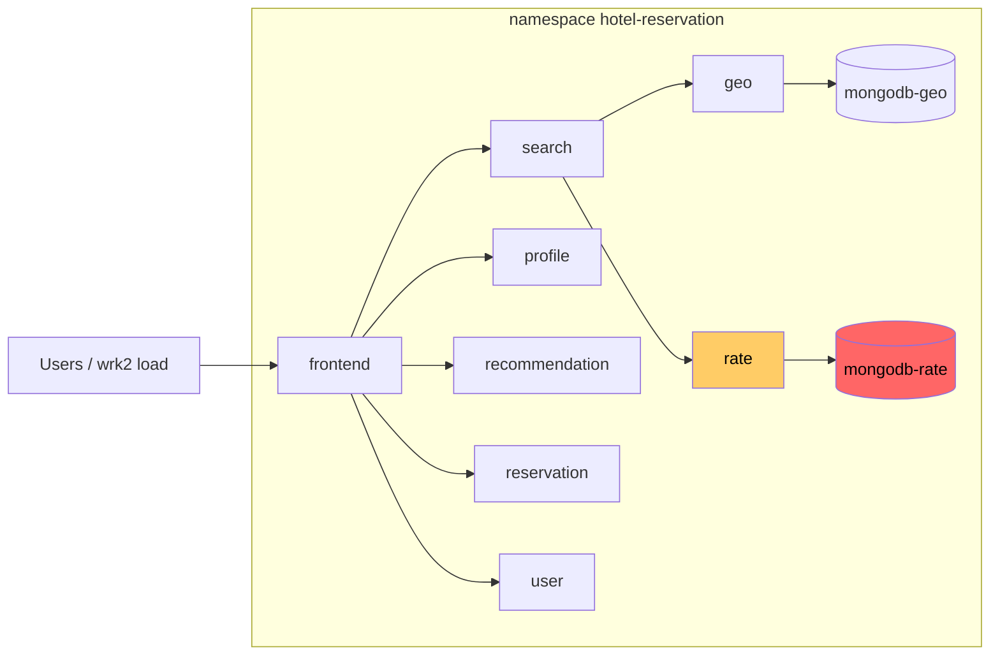

# Problem card: `storage_user_unregistered-2`

Status: **draft, from source only (30 Oct 2026)**. Nothing here comes from a run yet. The root cause, the injection
and the oracle names are read from the SREGym clone (`sregym/conductor/problems/`, `sregym/generators/fault/`).
Everything marked **[prediction]** or **[unverified]** is our reading and must be checked on a cluster or
after the first walkthrough run.

## 1. The story in two sentences
The Hotel Reservation rate service depends on `mongodb-rate`. SREGym removes the admin user from that MongoDB and restarts the dependent service (the `rate` service **[unverified mapping]**), so every storage call from it fails with an authorization error while all pods look Running. Users see search and rate-dependent pages fail or come back empty.

## 2. System map

Red = the database that lost its user. Orange = the service that now fails to authenticate. This is the `-2` variant (target `mongodb-rate`); `-1` targets `mongodb-geo` and is a different problem id.

## 3. Fault mechanics
- **Injected how** (from the SREGym source): `ApplicationFaultInjector` runs a script (`remove-admin-mongo.sh`) inside each `mongodb-rate` pod to remove the admin user, then deletes the dependent service's pods so they reconnect (`inject_app.py`). The app is built with `mount_failure_scripts=False`, so the agent cannot read the scripts.
- **Why it breaks:** MongoDB still runs, but the user the service authenticates with no longer exists. Authentication fails, so the service logs authorization errors. Nothing is crashed, so pod status looks healthy.
- **Symptoms an agent can see** **[prediction, order not checked on a cluster]**:
  1. `get_pod_status`: all pods Running (the misleading part).
  2. `get_logs` on the rate service: authentication or authorization errors against `mongodb-rate`. **[unverified wording]**
  3. `get_logs` / `describe` on `mongodb-rate`: Mongo itself is healthy, the user is missing. **[unverified]**

## 4. What a correct diagnosis must say
Derived from the structured `root_cause` the SREGym judge compares against. The judge's own checklist items (D1-Q*, D2-Q*, D3-Q*) are only visible after a run, so add them to this card after the first attempt.
- **D1 fault localization:** `service/mongodb-rate` in `hotel-reservation` (the structured root cause names the database, not the rate service).
- **D2 fault characterization:** Expected admin user credentials are missing from MongoDB, so the dependent service cannot authenticate and storage operations fail with authorization errors.
- **D3 scope precision:** Do not blame the rate service's code or other databases; the rate service is a symptom.

## 5. What a correct fix looks like
- **Accepted fix(es):** **[unverified, read `MitigationOracle`]** Recreate the missing MongoDB user so the dependent service can authenticate again, then the service recovers.
- **Fake fixes:** Restarting the rate service or `mongodb-rate` (the user stays missing); scaling anything.
- **Needs shell?** **[prediction]** Needs shell. None of the typed actions can create a MongoDB user; it takes an exec into the mongo pod. Typed-only should fail on the fix.

## 6. Open questions this problem speaks to
Tags are in `docs/research/open-questions.md`. Confirm the tags when the card is reviewed; the ones named in section 8 are suggestions.

## 7. Attempt log

| Attempt | Agent / action space / model | Result (diag, mit, e2e) | failure_mode_tag | story | What we learned |
|---|---|---|---|---|---|
| Ladder round 1 (3 Nov 2026), 15 variants x 1 repeat | `reliops_v1` / `reliops_v2` variants, `gemini-3.5-flash-lite` (agent and judge) | diag 13/15, mit 7/15, e2e 5/15 | - | stories in the Lab export | No run recreated the missing MongoDB user (the real fix). The fix check only needs the pods ready, so it accepted disabling MongoDB auth (removing `--auth`) and deleting the data volume (c1, c3, c7 passes). p1/p2 passed after only setting credential env vars on `rate`; why that worked is unverified. Report a clean count next to the raw one. |

## 8. Experiments to run on this problem
- [ ] Typed vs typed+shell (does the fix need exec?)
- [ ] Same fault, other target (`-1`, `mongodb-geo`) to see if the diagnosis transfers
