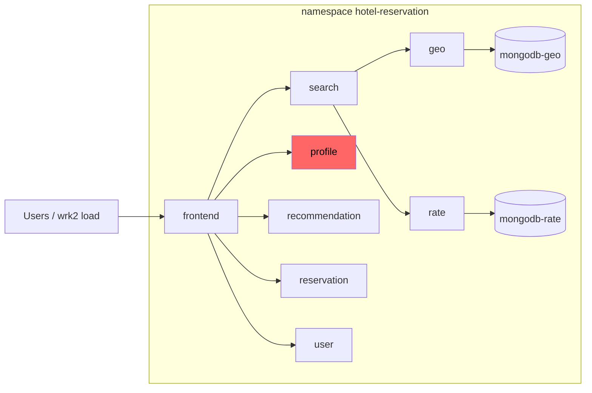

# Problem card: `wrong_dns_policy_hotel_reservation`

Status: **draft, from source only (30 Oct 2026)**. Nothing here comes from a run yet. The root cause, the injection
and the oracle names are read from the SREGym clone (`sregym/conductor/problems/`, `sregym/generators/fault/`).
Everything marked **[prediction]** or **[unverified]** is our reading and must be checked on a cluster or
after the first walkthrough run.

## 1. The story in two sentences
The profile service's Deployment is patched to use `dnsPolicy: None` with only the external resolver `8.8.8.8`. It can no longer resolve cluster-internal names, so calls it makes to `*.svc.cluster.local` services fail even though those services are healthy.

## 2. System map

Red = the profile deployment with the wrong DNS settings. The other services are healthy.

## 3. Fault mechanics
- **Injected how** (from the SREGym source): `kubectl patch` replaces `dnsPolicy` with `None` and adds `dnsConfig` with nameserver `8.8.8.8` and no search domains, then `kubectl rollout restart` and wait; SREGym checks `8.8.8.8` is in the pod's resolv.conf (`inject_virtual.py`).
- **Why it breaks:** With `dnsPolicy: None` the pod ignores CoreDNS. A public resolver cannot resolve `*.svc.cluster.local`, so the service fails name resolution for its dependencies.
- **Symptoms an agent can see** **[prediction, order not checked on a cluster]**:
  1. `get_pod_status`: pods Running (maybe restarts) **[unverified]**.
  2. `get_logs` on profile: name resolution errors for cluster-internal hosts **[unverified wording]**.
  3. `describe deployment profile`: `dnsPolicy: None`, `dnsConfig` nameserver 8.8.8.8.

## 4. What a correct diagnosis must say
Derived from the structured `root_cause` the SREGym judge compares against. The judge's own checklist items (D1-Q*, D2-Q*, D3-Q*) are only visible after a run, so add them to this card after the first attempt.
- **D1 fault localization:** `profile` deployment in `hotel-reservation`.
- **D2 fault characterization:** Invalid DNS policy (`dnsPolicy: None`) with an external resolver (`8.8.8.8`), so cluster-internal service names cannot be resolved.
- **D3 scope precision:** Do not blame CoreDNS, the network or the dependent services; they are healthy.

## 5. What a correct fix looks like
- **Accepted fix(es):** `DNSResolutionMitigationOracle` checks DNS resolution recovers. Remove the `dnsPolicy`/`dnsConfig` override (back to `ClusterFirst`) and roll out the deployment. **[unverified: exact oracle checks]**
- **Fake fixes:** Adding more resolvers while keeping `dnsPolicy: None`; restarting alone; editing CoreDNS (not the cause).
- **Needs shell?** **[prediction]** `rollback_deployment` may work, because the injection patches an existing Deployment and the history keeps the earlier revision. If it does not, a patch via the shell is needed.

## 6. Open questions this problem speaks to
Tags are in `docs/research/open-questions.md`. Confirm the tags when the card is reviewed; the ones named in section 8 are suggestions.

## 7. Attempt log

| Attempt | Agent / action space / model | Result (diag, mit, e2e) | failure_mode_tag | story | What we learned |
|---|---|---|---|---|---|

## 8. Experiments to run on this problem
- [ ] Does `rollback_deployment` alone fix it (typed-only)?
- [ ] Wrong-component trap: does the agent blame CoreDNS?
